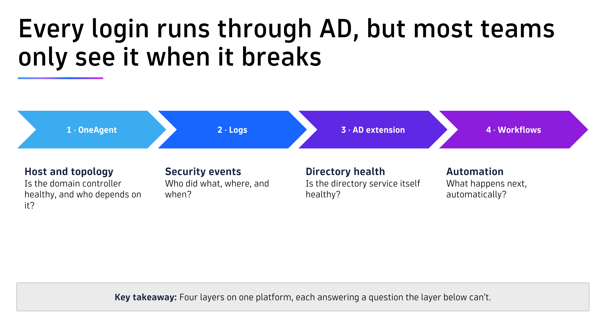
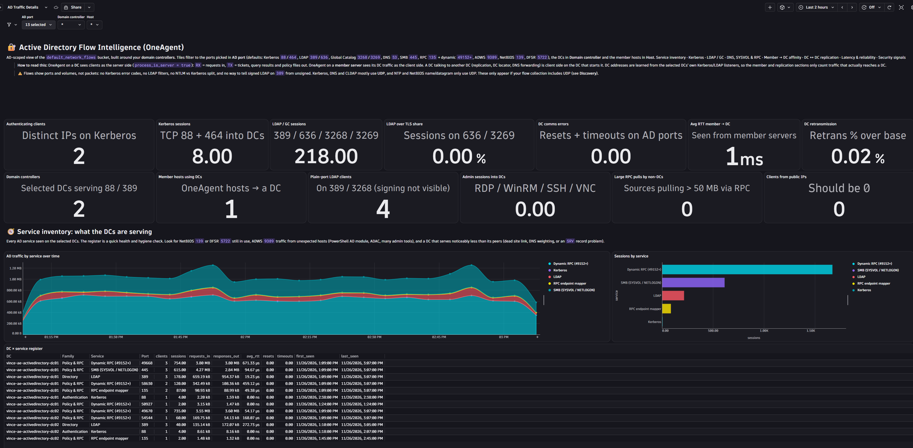
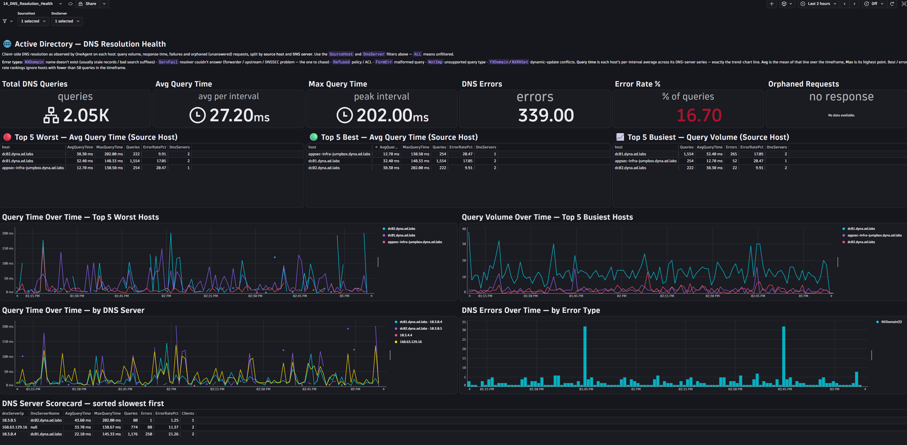
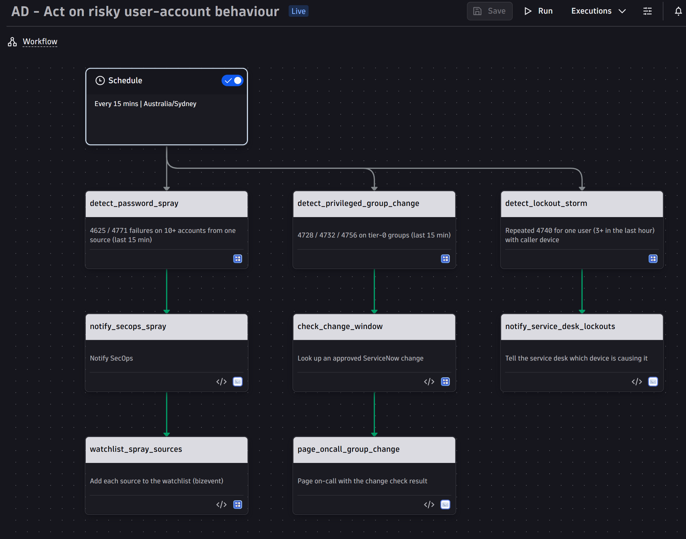

# Active Directory Observability: Dynatrace Tech Talk

> Every login runs through AD, but most teams only see it when it breaks.


Companion repo for the Dynatrace Tech Talk on monitoring Active Directory. It contains the dashboards and the workflow shown in the talk, as importable JSON.

## The idea: four layers on one platform

Each layer answers a question the layer below it can't.



| Layer | Answers | Built with |
|---|---|---|
| 1. OneAgent | Is the DC healthy, and who depends on it? | Infrastructure monitoring, Smartscape, Dynatrace Intelligence |
| 2. Logs | Who did what, where, and when? | OneAgent log module, OpenPipeline, Grail, DQL |
| 3. AD extension | Is the directory service healthy? | [Microsoft Active Directory monitoring extension](https://www.dynatrace.com/hub/detail/microsoft-active-directory-monitoring/) |
| 4. Workflows | What happens next, automatically? | Workflows, ServiceNow, Teams or Slack |

No extra tools: one agent, one data lake and one automation engine, so ops, security and the service desk see the same facts.

> This repo covers layers 1, 2 and 4. Layer 3 uses the [Microsoft Active Directory extension](https://www.dynatrace.com/hub/detail/microsoft-active-directory-monitoring/) from the Dynatrace Hub, so there is nothing to import for it.

## What's in the repo

```
.
├── dashboards/
│   ├── ad-traffic-details.json        # DC traffic by service, from OneAgent network flows
│   └── dns-resolution-health.json     # Client-side DNS health, from OneAgent DNS metrics
├── workflows/
│   └── ad-risky-account-behaviour.json  # Scheduled detection + response for risky accounts
└── docs/
    └── images/                        # Screenshots and slides used in this README
```

## Dashboards

### AD Traffic Details

[`dashboards/ad-traffic-details.json`](dashboards/ad-traffic-details.json)

Shows what your domain controllers are serving and who depends on them: Kerberos, LDAP / Global Catalog, DNS, SMB, RPC, ADWS and more. It also covers latency, retransmissions and security signals such as plain-port LDAP clients, admin sessions into DCs and clients from public IPs.

- **Data:** the `default_network_flows` bucket, populated by [OneAgent network connection monitoring](https://docs.dynatrace.com/docs/observe/infrastructure-observability/networks/network-devices/network-flows/oneagent-network-connection-monitoring).
- **Filters:** AD port, domain controller, host.



### DNS Resolution Health

[`dashboards/dns-resolution-health.json`](dashboards/dns-resolution-health.json)

Client-side DNS resolution as seen by OneAgent on each host: query volume, response time, failures by error type (NXDomain, ServFail, Refused and others) and orphaned requests. Includes top 5 best, worst and busiest hosts and a DNS server scorecard.

- **Data:** `dt.host.dns.*` metrics.
- **Filters:** source host, DNS server.



## Workflow: act on risky account behaviour

[`workflows/ad-risky-account-behaviour.json`](workflows/ad-risky-account-behaviour.json)

Runs every 15 minutes (timezone set to `Australia/Sydney`). It queries Windows Security event logs and runs three independent branches:

| Detection | Windows events | Response |
|---|---|---|
| Password spray: one source failing against 10+ accounts | 4625, 4771 | Email SecOps, then add the source to a watchlist (`ad.watchlist.add` bizevent) |
| Tier-0 group membership change | 4728, 4732, 4756 | Look up an approved ServiceNow change, then page on-call with the result |
| Lockout storm: 3+ lockouts for one user in the last hour | 4740 | Email the service desk with the caller device causing it |



## Getting started

### Prerequisites

- OneAgent on your domain controllers and member servers, with [network connection monitoring](https://docs.dynatrace.com/docs/observe/infrastructure-observability/networks/network-devices/network-flows/oneagent-network-connection-monitoring) enabled (for the traffic dashboard).
- Windows Security event logs from the DCs ingested into Grail as logs (for the workflow).
- A Dynatrace environment with Dashboards and Workflows.

### Import

- **Dashboards:** Dashboards app → **Upload** → select the JSON file.
- **Workflow:** Workflows app → **Upload** → select the JSON file.

### Configure the workflow before enabling it

The workflow ships with placeholders:

- **Email recipients:** replace `secops@example.com`, `ad-oncall@example.com` and `servicedesk@example.com`.
- **ServiceNow:** in `check_change_window`, set `SNOW_INSTANCE` and `CREDENTIAL_ID`. Add the instance to *Settings → External requests*. With no credential, the check reports `NOT CHECKED` and the page still goes out.
- **Tier-0 groups:** review the group list in the `detect_privileged_group_change` query so it matches your environment.
- **Schedule:** change the timezone if needed.

## Notes

- Network flows show ports and volumes, not packets. You can't see Kerberos error codes, tell NTLM from Kerberos, or tell signed from unsigned LDAP on 389.
- Dashboards and the workflow are examples to adapt, not production-ready defaults. Tune thresholds (10+ accounts, 3+ lockouts) to your environment.

## Resources

- [Microsoft Active Directory monitoring extension](https://www.dynatrace.com/hub/detail/microsoft-active-directory-monitoring/): Dynatrace Hub listing for the AD extension (layer 3).
- [OneAgent network connection monitoring](https://docs.dynatrace.com/docs/observe/infrastructure-observability/networks/network-devices/network-flows/oneagent-network-connection-monitoring): Dynatrace docs for the network flow data behind the AD Traffic Details dashboard.
- [Active Directory audit dashboards](https://github.com/Dynatrace/community-examples/tree/main/dashboards/active-directory-audit): official Dynatrace community examples, with more AD dashboards to explore.

> **Disclaimer:** This is a personal repository. It is **not an official Dynatrace product or repository** and is **not supported by Dynatrace**. The dashboards and workflow are examples shared from a tech talk, provided as-is with no warranty. Review and test them before using them in your own environment.

## License

Released into the public domain under [The Unlicense](LICENSE). Take it, adapt it, and share it, no attribution needed. See the disclaimer above: this is not an official Dynatrace repository and is not supported by Dynatrace.
